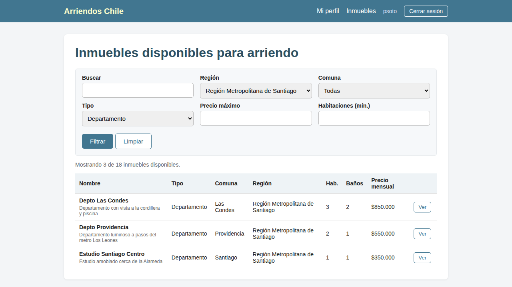
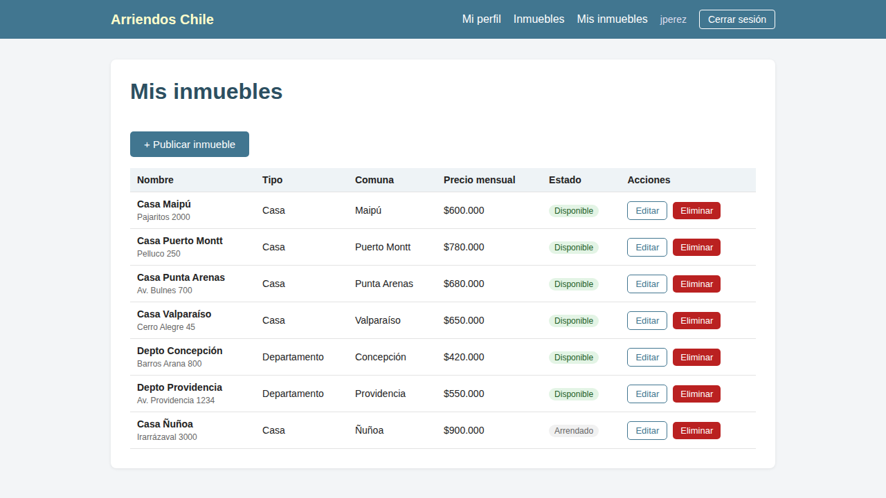
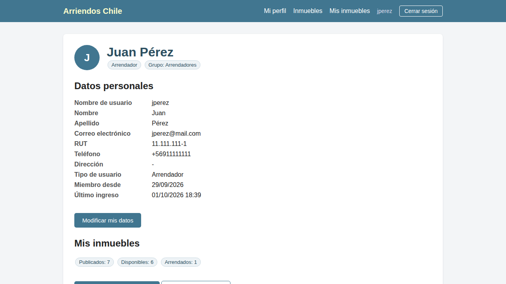
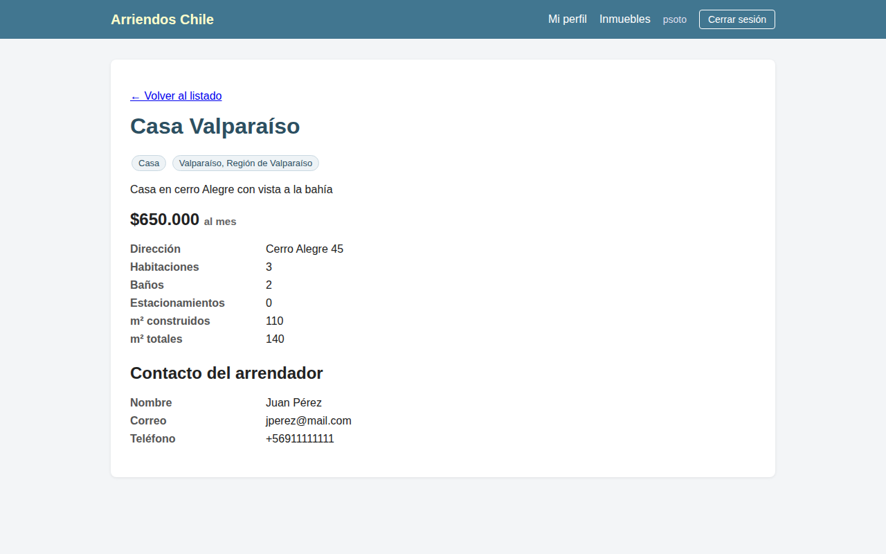
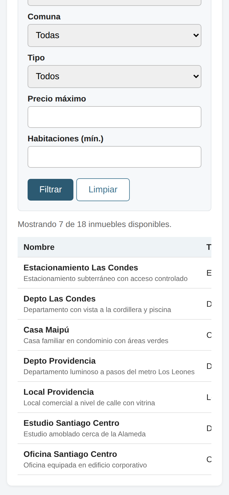

# Arriendos Chile 🏠

Sitio web para publicar y arrendar inmuebles en Chile. Los **arrendadores** publican, editan y eliminan sus propiedades; los **arrendatarios** revisan la oferta disponible y la filtran por región, comuna, tipo y precio.

Proyecto desarrollado durante el módulo *Acceso a datos en aplicaciones Python Django* del bootcamp Full Stack Python.



## Funcionalidades

- **Registro e inicio de sesión** con dos roles: arrendatario o arrendador.
- **Perfil personal**, donde el usuario ve y modifica sus datos.
- **CRUD de inmuebles**: cada arrendador agrega, edita y elimina solo los suyos.
- **Filtros** por región, comuna, tipo de inmueble, precio máximo, habitaciones y texto.
- **Detalle de cada inmueble** con el contacto del arrendador.
- **Datos reales de Chile**: 16 regiones y 346 comunas cargadas con `loaddata`.
- **Permisos por grupo** (Arrendatarios, Arrendadores, Administradores) y panel de administración.
- **Diseño adaptable a celulares.**
- **35 pruebas automáticas.**

## Tecnologías

Python 3 · Django 5.2 · PostgreSQL · HTML y CSS · django-auth · Django Admin

## Capturas

| Mis inmuebles (arrendador) | Perfil |
|---|---|
|  |  |

| Detalle de un inmueble | Vista en celular |
|---|---|
|  |  |

## Instalación

1. Clonar el repositorio y crear el entorno virtual:

```
git clone https://github.com/alvarolealmoraga-design/arriendos-chile.git
cd arriendos-chile
python -m venv venv
venv\Scripts\activate          # Windows  (Mac/Linux: source venv/bin/activate)
pip install -r requirements.txt
```

2. Crear la base de datos `arriendos` en PostgreSQL.
3. Copiar `.env.example` como `.env` y completar los datos de PostgreSQL. El archivo `.env` no se sube al repositorio.
4. Crear las tablas, cargar los datos y levantar el servidor:

```
python manage.py migrate
python manage.py loaddata regiones_comunas
python manage.py loaddata tipos_inmueble
python manage.py loaddata usuarios
python manage.py loaddata inmuebles
python manage.py runserver
```

Abrir http://127.0.0.1:8000/

### Usuarios de prueba

| Usuario | Contraseña | Rol |
|---|---|---|
| `jperez` | `clave1234` | Arrendador |
| `psoto` | `clave1234` | Arrendatario |
| `admin` | `Gestion.Casas#77` | Superusuario |

## Pruebas

```
python manage.py test
```

## Estructura

```
arriendos/        configuración del proyecto (settings, urls)
inmuebles/        modelos, formularios, vistas y datos (fixtures) de inmuebles
usuarios/         registro, login, perfil y edición de datos
templates/        plantilla base y página 403
reporte_*.py      reportes en texto con consultas SQL
```

## Autor

**Álvaro Leal Moraga** · [GitHub](https://github.com/alvarolealmoraga-design) · [LinkedIn](https://www.linkedin.com/in/alvaro-leal-moraga)
